# STM32F411 IMU Data Acquisition Pipeline

**English** | [Tiếng Việt](README_VI.md)

100 Hz 6-axis IMU acquisition on STM32F411CEU6 Black Pill with MPU6500, I2C DMA, 1 us timestamps, CRC-8 framing, USB CDC and Python dataset tooling.

## Key Results

| Metric | Recorded result |
|---|---|
| Acquisition rate | 100 Hz target; 99.96 Hz in the recorded 10 s benchmark |
| Timestamp resolution | 1 us/tick using TIM5; timestamp captured at DMA completion |
| Binary frame | 21 bytes, including sequence, timestamp and six IMU axes |
| CRC | CRC-8 polynomial `0x07` |
| 10 s benchmark | 1000/1000 frames; 0 CRC errors; 0 lost frames reported by the logger |
| Dataset | 5 classes × 3 sessions = 15 CSV files |

These are recorded results, not a new hardware test. CRC error counts come from terminal evidence; filtered CSV files alone cannot establish them. Continuous sequence numbers do not prove that every TIM2 sampling deadline was met. See [benchmark evidence](#7-repeat-the-10-second-benchmark), [report](report_EN.md) and [limitations](#12-evidence-limitations).

## LAB01 submission notes

| Item | Reference assignment | Repository implementation |
|---|---|---|
| Board / MCU | NUCLEO-F411RE | Black Pill STM32F411CEU6 |
| IMU | MPU6050 | MPU6500 |
| PC transport | USART2 DMA through ST-LINK VCP | Direct MCU USB CDC |
| IDE / toolchain | STM32CubeIDE | Keil µVision |
| I2C | 400 kHz | 100 kHz |
| SYSCLK | 100 MHz | 84 MHz |

**Status:** repository structure and data checks are complete. Available evidence does not establish compliance with every assignment requirement.

- [Results and assignment comparison](report_EN.md) | [Báo cáo tiếng Việt](report.md)
- [Original assignment HTML, in Vietnamese](docs/assignment/lab01.html)
- [English PDF guide](docs/LAB1_Guide_EN.pdf) | [PDF tiếng Việt](docs/LAB1_Huong_dan.pdf)
- [Quality summary for 15 sessions](docs/quality/summary.csv)
- [Verification record](docs/VERIFICATION_EN.md)
- [English and Vietnamese submission ZIPs](https://github.com/huynhtriphat01-star/stm32f411-imu-data/releases/tag/v1.0-lab1)

This implementation uses Black Pill, MPU6500, Keil and USB CDC. The reference assignment uses NUCLEO-F411RE, MPU6050, CubeIDE and UART DMA. Instructor approval is required for these substitutions.

Do not invent student ID, class, collector identity or sensor pose when these details have not been confirmed.

## Run the tools

```powershell
python -m pip install -r requirements.txt
python logger.py COM5 10
python tools/check_quality.py
python tools/psd_check.py
```

`collect.py` refuses to overwrite existing files. Both PDFs follow the current illustrated guide; use README and source code for acquisition commands.

Do not run Generate Code directly over the working project: the TIM5 period in `.ioc` does not fully represent `main.c`, and handwritten logic exists outside USER CODE regions. Back up first and review changes.

## 1. Scope and evidence

Documentation was checked against source code, `.ioc` configuration, saved build output and CSV files on 1 November 2026. Hardware was not rerun during documentation work.

The supplied ZIP contained 151 PNGs. Review selected 14 workflow screenshots and excluded 137 from the guide. No files had identical SHA-256 hashes; many showed near-duplicate content, intermediate settings, failed attempts or unrelated work. See the [evidence index](docs/EVIDENCE_INDEX_EN.md) and [original screenshot review](docs/evidence/SCREENSHOT_REVIEW.csv), whose source notes remain in Vietnamese.

- [Original image](docs/evidence/11_dataset_complete_original.png): unchanged for comparison.
- [Presentation image](docs/images/11_dataset_complete_annotated.png): cropped directly from the original; retained pixels are unchanged. Captions identify the main software and evidence.
- [Existing CSV audit](docs/evidence/csv_audit.csv): row counts, sequence checks, timestamp intervals and SHA-256 hashes.
- [Saved Keil build evidence](docs/evidence/07_build_flash_original.png): `0 Error(s), 0 Warning(s)`; this is not a new build. The previously referenced `docs/evidence/keil_build_log.htm` is absent; use the original screenshot.

## 2. Workflow

```text
MPU6500 -> I2C1 -> STM32F411
TIM2 100 Hz -> request 14-byte I2C DMA read
DMA completion -> capture TIM5 timestamp (1 us/tick)
Pack 21-byte frame + CRC-8 -> USB CDC -> COM5
logger.py -> 10 s check -> benchmark CSV
collect.py -> raw/<class>/session_<id>.csv
5 classes x 3 sessions -> 15 CSV files -> end of LAB1
```

Timestamps are captured at DMA completion, not at the TIM2 interrupt edge. LAB2 windowing, dataset splitting and normalization are outside this guide.

## 3. Hardware

| STM32F411 | Connection |
|---|---|
| PB8 | MPU6500 SCL |
| PB9 | MPU6500 SDA |
| GND | Common ground with sensor |
| Module-compatible supply | Check module supply marking and 3.3 V logic compatibility before powering |
| PA11 / PA12 | USB D- / D+ through board USB connector |
| PA13 / PA14 | ST-LINK SWDIO / SWCLK |

Firmware uses 7-bit I2C address `0x68` (`0x68 << 1` in HAL calls) and checks `WHO_AM_I = 0x70`. Set AD0 for address `0x68`; verify SCL/SDA pull-ups use a suitable logic voltage. Sensor ranges are ±4 g and ±500 dps. The user-supplied assembly photo appears below.

## 4. CubeMX configuration

Open `F411_IMU_LAB1.ioc`. Compare these settings before editing or generating code.

| Item | Value checked against the project |
|---|---|
| MCU | STM32F411CEU6 |
| HSE | 25 MHz, crystal oscillator |
| PLL | M=25, N=336, P=4, Q=7 |
| SYSCLK / HCLK | 84 MHz |
| USB clock | 48 MHz |
| APB1 | 42 MHz; APB1 timer clock 84 MHz |
| TIM2 | Internal Clock; PSC=8399; ARR=99; TIM2 interrupt enabled |
| TIM5 | Internal Clock; PSC=83; Period=0xFFFFFFFF in `main.c` |
| I2C1 | PB8/PB9; 100 kHz in `main.c` |
| I2C1 RX DMA | DMA1 Stream0, Channel 1; Normal; byte; Memory Increment; High priority |
| NVIC | DMA1 Stream0, I2C1 event/error, TIM2 and OTG_FS enabled |
| USB_OTG_FS | Device Only |
| USB_DEVICE | Communication Device Class (CDC) |
| SYS Debug | Serial Wire |

TIM2: `84,000,000 / (8399+1) / (99+1) = 100 Hz`.

TIM5: `84,000,000 / (83+1) = 1,000,000 Hz`, so 1 tick = 1 us. The 32-bit counter wraps after approximately 71.6 minutes.

**Reproduction note:** `.ioc` does not fully represent every setting in `main.c`, including the TIM5 period. Handwritten acquisition logic exists outside several USER CODE regions. Back up or commit before Generate Code and inspect the diff to prevent losing it.

## 5. Build and flash with Keil

1. Open `MDK-ARM/F411_IMU_LAB1.uvprojx` in Keil µVision.
2. Compare the recorded environment: ARM Compiler 6.24; CMSIS 6.4.0; STM32F4xx_DFP 3.1.1.
3. Build target `F411_IMU_LAB1`. Saved evidence reports 0 errors and 0 warnings.
4. Connect ST-LINK using SWD, GND and the probe's required target voltage reference.
5. Select ST-LINK and an STM32F411-compatible flash algorithm in Options for Target. Download, wait for successful verification, then run or reset the board.
6. Connect a USB data cable. Check the CDC port under Device Manager > Ports (COM & LPT).

The recorded session used **COM5**; another PC may assign a different port. Original screenshot 145426 shows Build 0 Error(s), 0 Warning(s), Programming Done and Verify OK. Screenshot 173501 shows USB Serial Device (COM5). Hardware was not reflashed during documentation work.

## 6. The 21-byte frame protocol

| Byte | Field | Format |
|---|---|---|
| 0-1 | SOF | `AA 55` |
| 2-3 | Sequence | uint16, little-endian |
| 4-7 | Timestamp | uint32, us, little-endian |
| 8-13 | ax, ay, az | 3 × int16, little-endian |
| 14-19 | gx, gy, gz | 3 × int16, little-endian |
| 20 | CRC | CRC-8 over bytes 0..19 |

CRC polynomial `0x07`, initial `0x00`; source uses left shifts, no bit reflection and no final XOR. Python decodes the payload with `struct.unpack("<HIhhhhhh", frame[2:20])`.

Acceleration: raw / 8192.0 gives g. Angular velocity: raw / 65.5 gives dps. The 14-byte I2C burst includes temperature; transmitted frames contain only the six motion axes.

## 7. Repeat the 10-second benchmark

Open PowerShell in the project directory:

```powershell
# Open a terminal in the downloaded project directory.
python --version
python -m pip install pyserial
python -m serial.tools.list_ports
python logger.py COM5 10
```

Close Serial Monitor and other programs holding COM5. The logger creates a new `imu_YYYYMMDD_HHMMSS.csv` in the current directory. Two recorded benchmark CSVs are preserved in [docs/evidence/benchmark/](docs/evidence/benchmark/).

| Metric | Recorded result |
|---|---|
| Requested duration | 10 s |
| Good frames | 1000 |
| CRC errors | 0 |
| Lost frames | 0 |
| Rate | 99.96 Hz in screenshot 145837; approximately 99.9-100 Hz |

Main benchmark screenshot 145837 reports 99.96 Hz; another run, 174012, reports 99.92 Hz. Both preserved benchmark CSVs have 1000 rows and continuous sequences. These are recorded outcomes, not a guarantee of exactly 1000 samples in every run. Terminal `Rate` uses PC time; `csv_audit.csv` uses MCU timestamps, so the rates may differ slightly.

CSV files contain only frames that passed CRC. Reading them cannot establish the number of rejected frames; terminal logs or original screenshots are required. Continuous saved sequences do not replace external jitter measurements.

## 8. Collect 5 classes × 3 sessions

| Class | Intended movement |
|---|---|
| idle | Keep the sensor still |
| wave | Wave back and forth |
| circle | Move in a circle |
| updown | Move up and down |
| shake | Shake the sensor |

Collect each session for 60 s. Begin moving when `START MOVEMENT NOW` appears. Keep grip and axis conventions consistent. These are acquisition instructions, not verification of the movement in each saved file.

**Overwrite protection:** `collect.py` uses file mode `x`. It rejects an existing class/session filename. The project already contains all 15 files; back up or use a new working directory before collecting again.

Example with an explicit file check:

```powershell
if (Test-Path 'raw\idle\session_01.csv') {
    throw 'File already exists. Back up the data before collecting again.'
}
python collect.py COM5 idle 01 60
```

Repeat for classes `idle`, `wave`, `circle`, `updown`, `shake` and sessions `01`, `02`, `03`. Change both class and session in each command.

Command used for the final session:

```powershell
# Run only if the target file is absent or has been backed up.
python collect.py COM5 updown 03 60
```

The final screenshot records `updown 03`: **6001 frames; 0 CRC; 0 lost; 99.99 Hz**. This is a 60 s collection, distinct from the 1000-frame/10 s benchmark.

See the completed-dataset screenshot in the gallery below.

## 9. Check files and directory structure

```powershell
(Get-ChildItem raw -Recurse -Filter *.csv).Count
Get-ChildItem raw -Recurse -Filter *.csv |
    Group-Object DirectoryName |
    Select-Object Name, Count
Get-ChildItem raw\updown
```

Expected: 15 CSVs in total, 3 per class, named session_01/02/03.csv. Check filenames as well as counts to avoid counting unrelated files.

```text
F411_IMU_LAB1/
|-- F411_IMU_LAB1.ioc
|-- Core/                 firmware and interrupts
|-- Drivers/              HAL/CMSIS
|-- Middlewares/          USB middleware
|-- USB_DEVICE/           USB CDC
|-- MDK-ARM/              Keil project
|-- logger.py             benchmark
|-- collect.py            class/session acquisition
|-- raw/
|   |-- idle/             session_01.csv, session_02.csv, session_03.csv
|   |-- wave/             session_01.csv, session_02.csv, session_03.csv
|   |-- circle/           session_01.csv, session_02.csv, session_03.csv
|   |-- updown/           session_01.csv, session_02.csv, session_03.csv
|   `-- shake/            session_01.csv, session_02.csv, session_03.csv
|-- docs/images/          cropped presentation images
|-- docs/evidence/        originals and CSV audit
|-- README.md             English guide
`-- README_VI.md          Vietnamese guide
```

## 10. Troubleshooting

| Symptom | Checks |
|---|---|
| COM5 missing | USB data cable, running board, USB clock 48 MHz, CDC enabled; use list_ports to find the assigned port |
| Access denied / port busy | Close previous loggers, Serial Monitor and other programs holding the port |
| No frames | Supply, GND, PB8/PB9, address 0x68, WHO_AM_I 0x70; TIM2/DMA/I2C/USB interrupts |
| DMA never completes | Stream0/Channel1, NVIC and source IRQ handlers |
| CRC errors increase | SOF, 21-byte frame, CRC over bytes 0..19, matching firmware/logger versions |
| Lost frames increase | Sequence and USB load; inspect usb_busy_count, dma_error_count, missed_deadline_count in debugger |
| Rate far from 100 Hz | Timer clock 84 MHz, PSC=8399, ARR=99; distinguish PC rate from MCU timestamp rate |
| Fewer than 15 CSVs | Group by directory; identify the missing class/session before collecting |
| Previous session file missing | Current collector refuses overwrites; check the tool/version used and restore from backup or Git if available |
| Errors after Generate Code | Compare with the working version and restore overwritten handwritten logic before building |

## 11. Update documentation on GitHub

Keep `README.md`, `README_VI.md` and `docs/` paths consistent so relative links continue to work.

```powershell
git status --short
git diff -- README.md README_VI.md docs
git add -- README.md README_VI.md docs
git diff --cached --stat
git commit -m "docs: update LAB1 acquisition guide and evidence"
```

These commands stage documentation only. Check the diff, remote and branch before pushing; do not stage firmware or datasets for a documentation-only update.

## 12. Evidence limitations

This implementation uses Black Pill and USB CDC. Document the differences and obtain instructor approval if the rubric requires NUCLEO and USART2 DMA. Evidence covers CubeMX, Flash Verify OK, Device Manager COM5 and the 10 s benchmark. The assembly photo does not verify individual pins. Some source screenshots show intermediate settings; the review table identifies them, and the guide selects the final settings. Presentation images are direct crops, with no regenerated text or numbers. Use originals for complete context.

## Actual hardware assembly

The user-supplied photo shows an IMU module, STM32 board, breadboard and jumper wires. It cannot establish individual pins, supply voltage or wire-color mapping. PB8=SCL and PB9=SDA come from source configuration, not visual wire tracing.

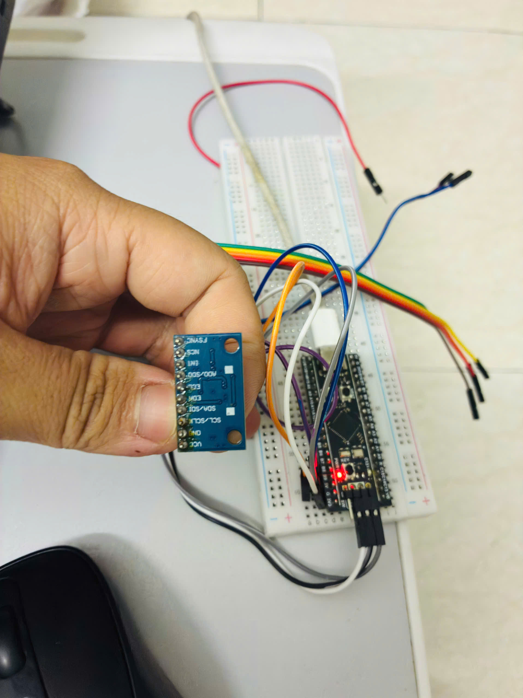

*Actual hardware photo (no software) - assembly overview.*

[Original photo](docs/evidence/00_hardware_original.jpg)

## 13. Illustrated guide

Each screenshot is cropped directly from its original, removing unrelated UI while preserving technical evidence. Captions name the main application. Open originals for full context. Configuration and debug images follow teaching order, not capture time. English captions translate the explanation; original application text remains unchanged.

### 01. Identify the MPU6500

Watch: WHO_AM_I = 0x70 and I2C HAL_OK. This is the initial identification test.

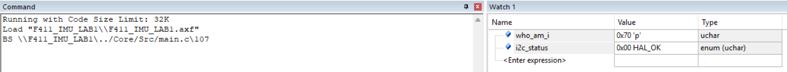

*Keil µVision - 01. Identify the MPU6500.*

[Original screenshot 124400](docs/evidence/14_whoami_original.png)

### 02. SYSCLK 84 MHz and USB 48 MHz

HSE 25 MHz; PLL M=25, N=336, P=4, Q=7. SYSCLK 84 MHz; USB 48 MHz.

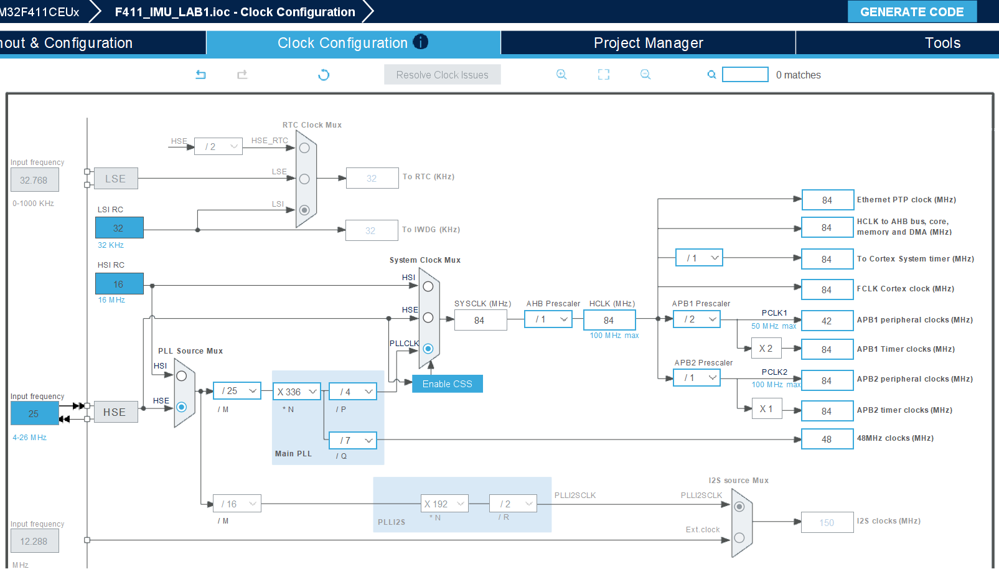

*STM32CubeMX - 02. SYSCLK 84 MHz and USB 48 MHz.*

[Original screenshot 141948](docs/evidence/01_clock_original.png)

### 03. TIM2 sampling at 100 Hz

PSC=8399; ARR=99; timer clock 84 MHz. 84 MHz / 8400 / 100 = 100 Hz.

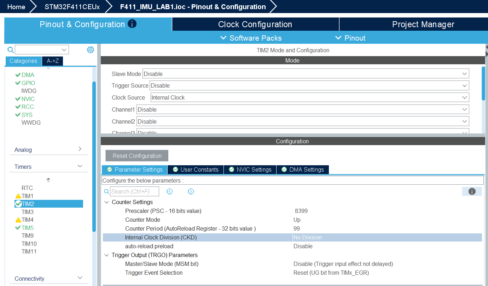

*STM32CubeMX - 03. TIM2 sampling at 100 Hz.*

[Original screenshot 142134](docs/evidence/02_tim2_original.png)

### 04. TIM2 interrupt

Enable TIM2 global interrupt. This image demonstrates interrupt enable only; final timer values appear in the previous image.

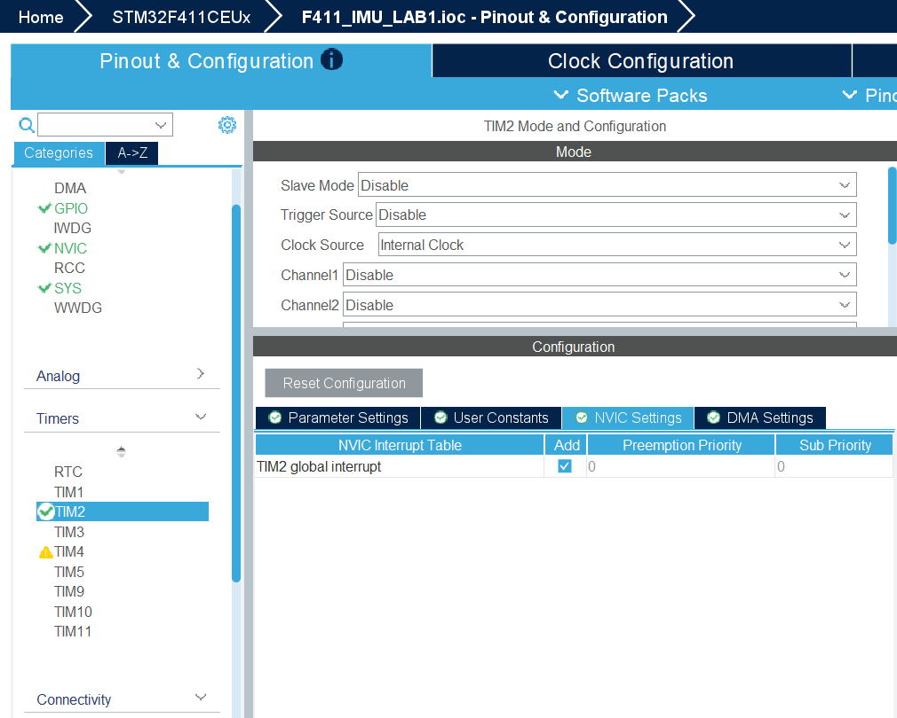

*STM32CubeMX - 04. TIM2 interrupt.*

[Original screenshot 134416](docs/evidence/12_tim2_irq_original.png)

### 05. TIM5 timestamps at 1 us

PSC=83; Period=4294967295 (0xFFFFFFFF). Timer clock 84 MHz gives 1 tick = 1 us.

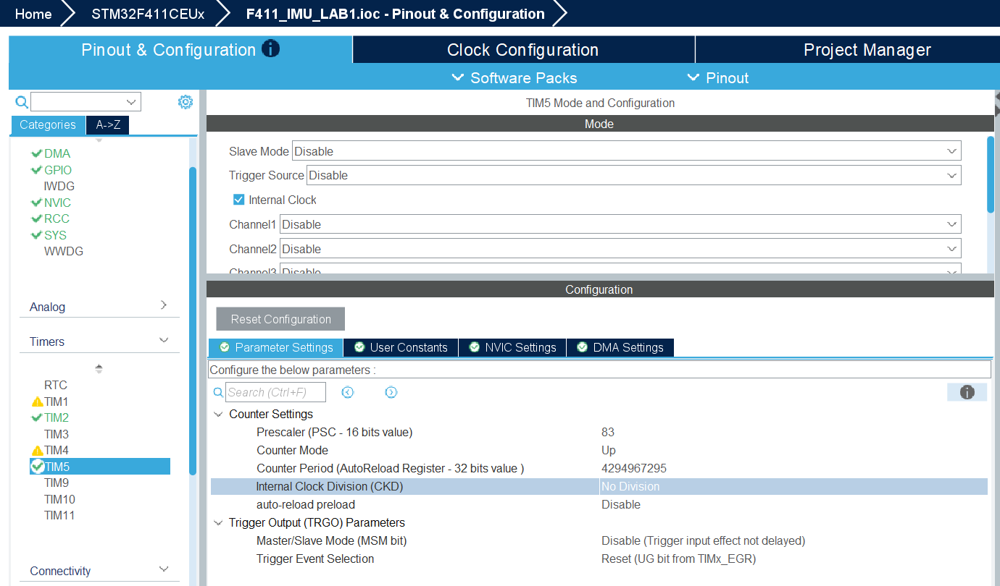

*STM32CubeMX - 05. TIM5 timestamps at 1 us.*

[Original screenshot 142218](docs/evidence/03_tim5_original.png)

### 06. I2C1 RX DMA

DMA1 Stream0; Peripheral To Memory; High; Normal; Memory Increment; Byte data. Channel 1 is checked against MSP source.

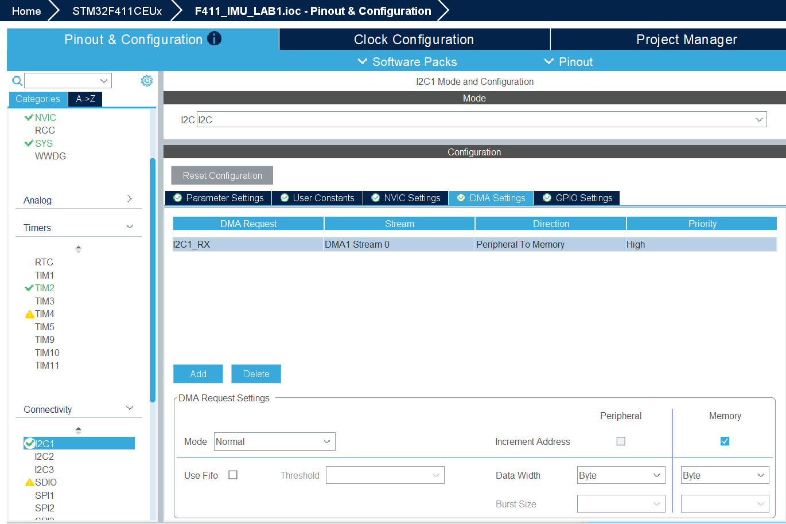

*STM32CubeMX - 06. I2C1 RX DMA.*

[Original screenshot 134754](docs/evidence/04_dma_original.png)

### 07. NVIC for I2C and DMA

DMA1 Stream0 global interrupt, I2C1 event and I2C1 error interrupts are all enabled.

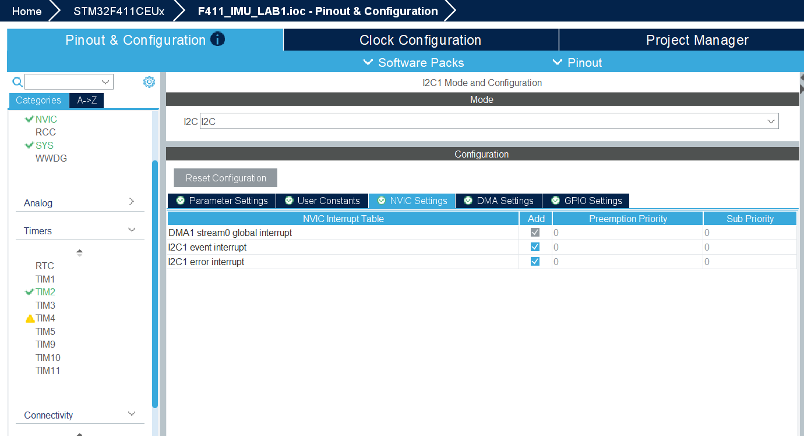

*STM32CubeMX - 07. NVIC for I2C and DMA.*

[Original screenshot 134746](docs/evidence/05_nvic_original.png)

### 08. USB OTG FS Device Only

USB_OTG_FS: Device_Only; Device Full Speed 12 MBit/s. This is USB bus speed, not the sampling rate.

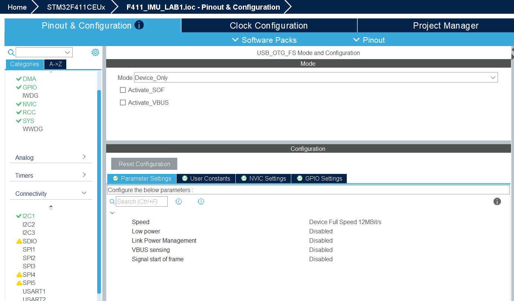

*STM32CubeMX - 08. USB OTG FS Device Only.*

[Original screenshot 142247](docs/evidence/13_usb_mode_original.png)

### 09. USB_DEVICE CDC

Class For FS IP: Communication Device Class (Virtual Port Com). This creates a virtual COM port over USB.

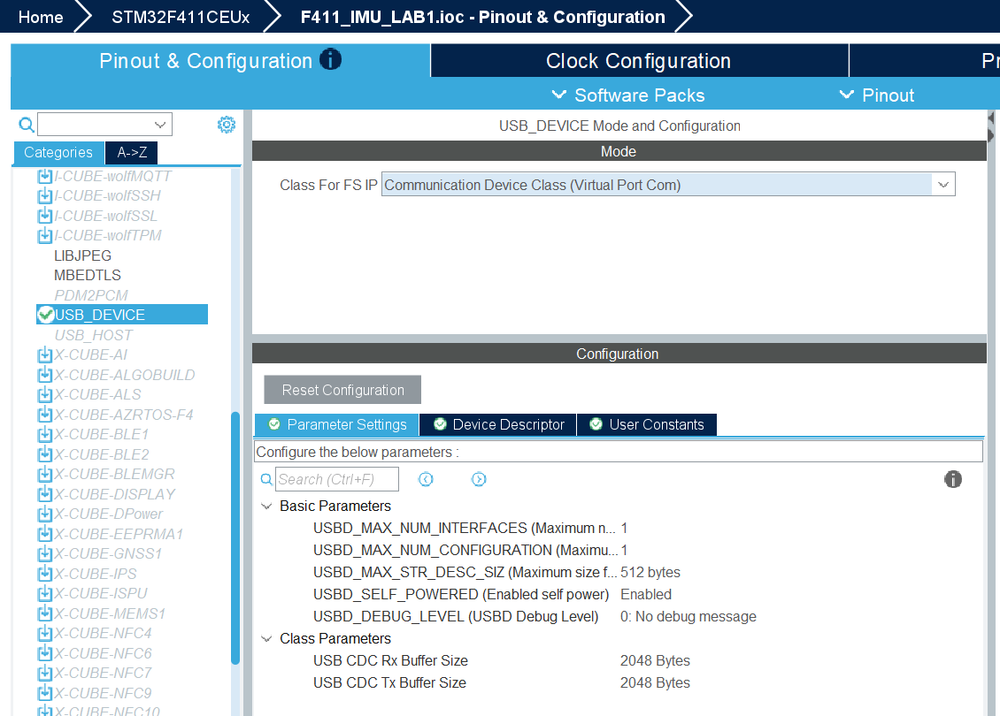

*STM32CubeMX - 09. USB_DEVICE CDC.*

[Original screenshot 142830](docs/evidence/06_cdc_original.png)

### 10. Keil build and Flash Verify OK

Build: 0 Error(s), 0 Warning(s). Programming Done and Verify OK. These are recorded results, not a new build or flash.

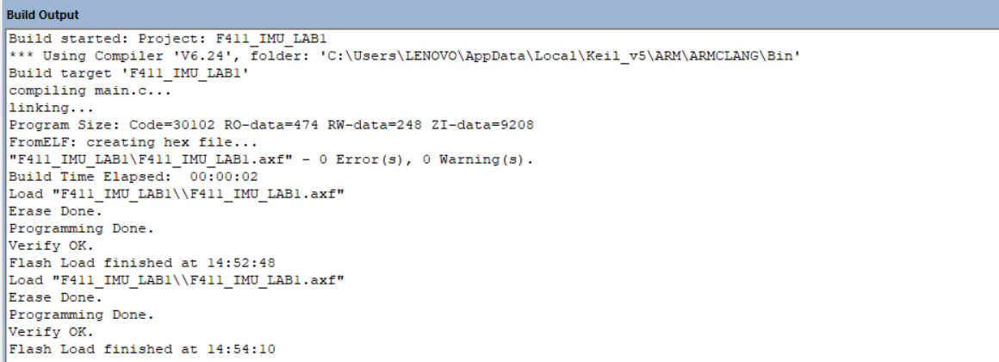

*Keil µVision - 10. Keil build and Flash Verify OK.*

[Original screenshot 145426](docs/evidence/07_build_flash_original.png)

### 11. Windows detects COM5

Device Manager shows USB Serial Device (COM5). COM3 in the same list belongs to another device.


*Windows Device Manager - 11. Windows detects COM5.*

[Original screenshot 173501](docs/evidence/08_com5_original.png)

### 12. Python benchmark for 10 s

1000 frames; 0 CRC; 0 lost; 99.96 Hz. The CSV audit confirms 1000 rows in imu_20261101_145817.csv.

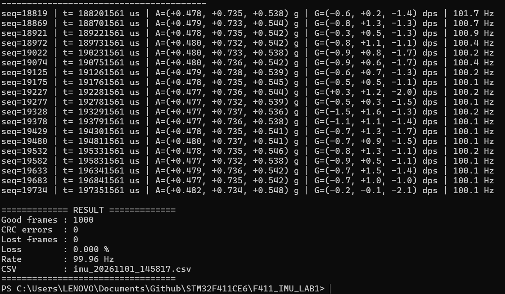

*Windows PowerShell / Python - 12. Python benchmark for 10 s.*

[Original screenshot 145837](docs/evidence/09_benchmark_original.png)

### 13. Collect by class and session

Top: idle 01 completed with 6001 frames at 99.99 Hz. Bottom: idle 02 starts a 60 s collection. Do not attribute the idle 01 result to idle 02.

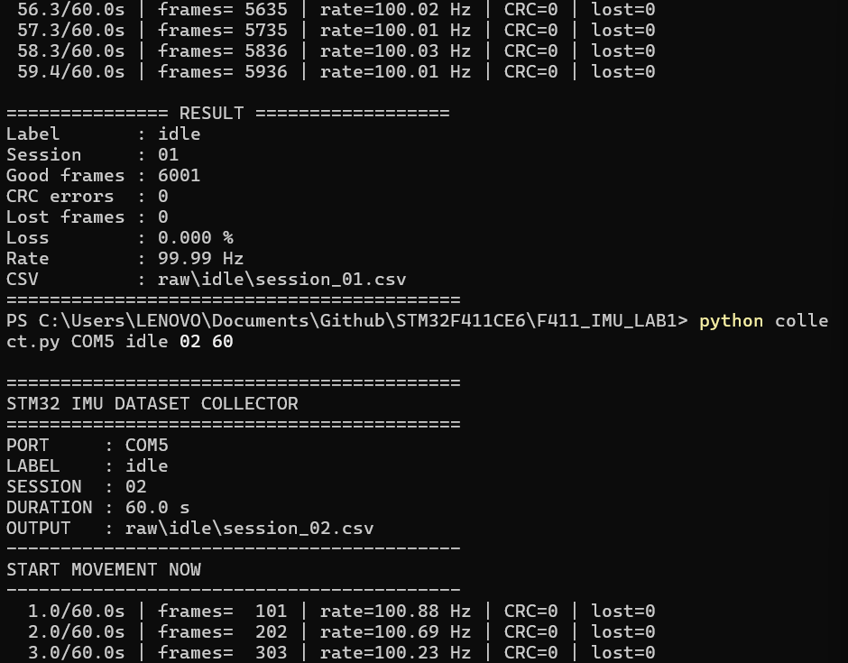

*Windows PowerShell / Python - 13. Collect by class and session.*

[Original screenshot 174639](docs/evidence/10_collector_original.png)

### 14. Complete all 15 CSV files

updown 03: 6001 frames; 0 CRC; 0 lost; 99.99 Hz. The count command returns 15; updown lists session_01/02/03. The file audit confirms 5 classes x 3 sessions.

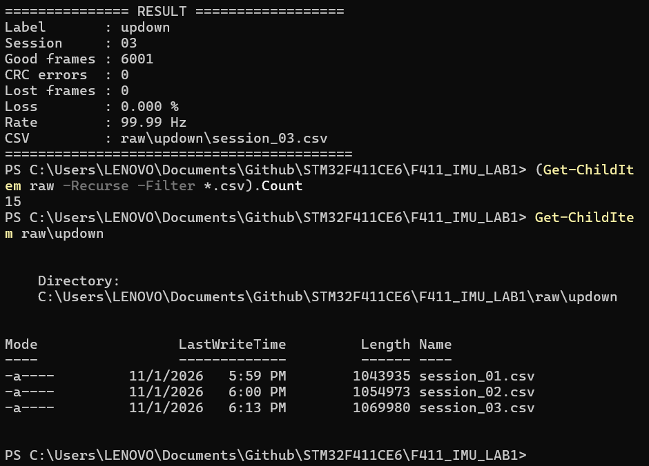

*Windows PowerShell / Python - 14. Complete all 15 CSV files.*

[Original screenshot 181343](docs/evidence/11_dataset_complete_original.png)
