# Thu thập dữ liệu IMU với STM32F411

[English](README.md) | **Tiếng Việt**

Thu thập IMU 6 trục ở 100 Hz trên STM32F411CEU6 Black Pill với MPU6500, I2C DMA, timestamp 1 us, frame CRC-8, USB CDC và công cụ dataset Python.

## Kết quả chính

| Chỉ số | Kết quả đã ghi nhận |
|---|---|
| Tần số thu dữ liệu | Mục tiêu 100 Hz; đạt 99.96 Hz trong benchmark 10 s đã lưu |
| Độ phân giải timestamp | 1 us/tick bằng TIM5; lấy timestamp khi DMA hoàn tất |
| Frame nhị phân | 21 byte, gồm sequence, timestamp và sáu trục IMU |
| CRC | CRC-8 đa thức `0x07` |
| Benchmark 10 s | 1000/1000 frame; logger báo 0 CRC errors và 0 lost frames |
| Dataset | 5 lớp × 3 phiên = 15 file CSV |

Đây là kết quả đã ghi nhận, không phải phép thử phần cứng mới. Số lỗi CRC lấy từ bằng chứng terminal; CSV đã lọc không tự chứng minh được chỉ số này. Sequence liên tục không chứng minh mọi nhịp TIM2 đều được đáp ứng. Xem [benchmark](#7-chạy-lại-benchmark-10-giây), [báo cáo](report.md) và [giới hạn](#12-giới-hạn-hồ-sơ).

## Ghi chú nộp LAB01

| Hạng mục | Đề bài mẫu | Triển khai trong repo |
|---|---|---|
| Board / MCU | NUCLEO-F411RE | Black Pill STM32F411CEU6 |
| IMU | MPU6050 | MPU6500 |
| Truyền dữ liệu tới PC | USART2 DMA qua ST-LINK VCP | USB CDC trực tiếp từ MCU |
| IDE / toolchain | STM32CubeIDE | Keil uVision |
| I2C | 400 kHz | 100 kHz |
| SYSCLK | 100 MHz | 84 MHz |

**Tình trạng:** đã chuẩn hóa cấu trúc và bổ sung kiểm tra dữ liệu. Chưa đủ bằng chứng để tuyên bố đạt toàn bộ đề bài.

- [Báo cáo kết quả và đối chiếu đề bài](report.md)
- [Đề bài gốc HTML](docs/assignment/lab01.html)
- [Hướng dẫn PDF tiếng Việt](docs/LAB1_Huong_dan.pdf) | [English PDF](docs/LAB1_Guide_EN.pdf)
- [Hai bộ ZIP tiếng Việt và tiếng Anh](https://github.com/huynhtriphat01-star/stm32f411-imu-data/releases/tag/v1.0-lab1)
- [Bảng chất lượng 15 phiên](docs/quality/summary.csv)
- [Kiểm tra sau chỉnh sửa](docs/VERIFICATION.md)

Hồ sơ dùng Black Pill, MPU6500, Keil và USB CDC. Đề bài mẫu dùng NUCLEO-F411RE, MPU6050, CubeIDE và UART DMA. Cần giảng viên chấp nhận phương án thay thế.

Không tự điền mã sinh viên, lớp, người thu hay tư thế khi chưa có thông tin xác nhận.

## Chạy công cụ

```powershell
python -m pip install -r requirements.txt
python logger.py COM5 10
python tools/check_quality.py
python tools/psd_check.py
```

`collect.py` hiện từ chối ghi đè file đã tồn tại. PDF được làm mới từ phần hướng dẫn bằng ảnh hiện tại; README và mã nguồn là tài liệu tham chiếu cho lệnh thu dữ liệu.

Không Generate Code trực tiếp lên bản đang hoạt động: TIM5 period trong `.ioc` chưa biểu diễn đầy đủ `main.c`, và nhiều logic viết tay nằm ngoài vùng USER CODE. Sao lưu trước rồi so sánh thay đổi.

## 1. Phạm vi và bằng chứng

Tài liệu được đối chiếu với source, cấu hình `.ioc`, log build và CSV tại project ngày 01/11/2026. Không chạy lại phần cứng trong lần biên soạn này.

Bản cập nhật đã rà 151 ảnh PNG trong ZIP người dùng cung cấp, chọn 14 ảnh theo workflow và loại 137 ảnh khỏi hướng dẫn. Không có file trùng SHA-256; có nhiều ảnh gần lặp, cấu hình trung gian, lượt thử lỗi và ảnh ngoài LAB1. Xem [sổ bằng chứng](docs/EVIDENCE_INDEX.md) và [bảng lọc từng ảnh](docs/evidence/SCREENSHOT_REVIEW.csv).

- [Ảnh gốc](docs/evidence/11_dataset_complete_original.png): giữ nguyên để đối chiếu.
- [Ảnh chú thích](docs/images/11_dataset_complete_annotated.png): bản crop trực tiếp từ ảnh gốc, giữ nguyên pixel trong vùng nội dung. Caption bên dưới ghi phần mềm và nội dung cần đối chiếu.
- [Kiểm tra CSV hiện có](docs/evidence/csv_audit.csv): số dòng, sequence, khoảng timestamp và SHA-256.
- [Ảnh build Keil gốc đã lưu](docs/evidence/07_build_flash_original.png): `0 Error(s), 0 Warning(s)`; không phải kết quả build mới. Link log `docs/evidence/keil_build_log.htm` trước đây không có file tương ứng trong repo; dùng ảnh gốc để đối chiếu.

## 2. Workflow

```text
MPU6500 -> I2C1 -> STM32F411
TIM2 100 Hz -> yêu cầu đọc I2C DMA 14 byte
DMA hoàn tất -> lấy timestamp từ TIM5 (1 us/tick)
Đóng frame 21 byte + CRC-8 -> USB CDC -> COM5
logger.py -> kiểm tra 10 s -> CSV benchmark
collect.py -> raw/<class>/session_<id>.csv
5 class x 3 session -> 15 CSV -> kết thúc LAB1
```

Timestamp được lấy khi DMA hoàn tất, không phải ngay tại cạnh ngắt TIM2. LAB2 xử lý cửa sổ, chia tập và chuẩn hóa nằm ngoài phạm vi tài liệu này.

## 3. Phần cứng

| STM32F411 | Kết nối |
|---|---|
| PB8 | SCL của MPU6500 |
| PB9 | SDA của MPU6500 |
| GND | GND chung với cảm biến |
| Nguồn phù hợp module | Kiểm tra nhãn nguồn và mức logic 3.3 V của module trước khi cấp |
| PA11 / PA12 | USB D- / D+ qua cổng USB của board |
| PA13 / PA14 | SWDIO / SWCLK của ST-LINK |

Firmware dùng địa chỉ I2C 7-bit `0x68` (`0x68 << 1` khi gọi HAL), kiểm tra `WHO_AM_I = 0x70`. Đặt AD0 tương ứng địa chỉ `0x68`; kiểm tra pull-up SCL/SDA về mức logic phù hợp. Cảm biến cấu hình accel ±4 g và gyro ±500 dps. Đã bổ sung ảnh lắp nối thực tế do người dùng cung cấp; xem mục ảnh phần cứng bên dưới.

## 4. Cấu hình CubeMX

Mở `F411_IMU_LAB1.ioc`. Đối chiếu bảng sau trước khi sửa hoặc Generate Code.

| Mục | Giá trị đối chiếu từ project |
|---|---|
| MCU | STM32F411CEU6 |
| HSE | 25 MHz, crystal oscillator |
| PLL | M=25, N=336, P=4, Q=7 |
| SYSCLK / HCLK | 84 MHz |
| USB clock | 48 MHz |
| APB1 | 42 MHz; timer APB1 chạy 84 MHz |
| TIM2 | Internal Clock; PSC=8399; ARR=99; bật ngắt TIM2 |
| TIM5 | Internal Clock; PSC=83; Period=0xFFFFFFFF trong `main.c` |
| I2C1 | PB8/PB9; 100 kHz trong `main.c` |
| I2C1 RX DMA | DMA1 Stream0, Channel 1; Normal; byte; Memory Increment; High priority |
| NVIC | DMA1 Stream0, I2C1 event/error, TIM2 và OTG_FS enabled |
| USB_OTG_FS | Device Only |
| USB_DEVICE | Communication Device Class (CDC) |
| SYS Debug | Serial Wire |

TIM2: `84,000,000 / (8399+1) / (99+1) = 100 Hz`.

TIM5: `84,000,000 / (83+1) = 1,000,000 Hz`, tức 1 tick = 1 us. Counter 32-bit quay vòng sau khoảng 71.6 phút.

**Lưu ý tái tạo:** `.ioc` không biểu diễn đầy đủ mọi giá trị được đặt trong `main.c`, ví dụ Period của TIM5. Code hiện có chứa logic viết tay ngoài nhiều vùng USER CODE. Sao lưu/commit trước khi Generate Code; kiểm tra diff để tránh mất logic thu dữ liệu.

## 5. Keil build và nạp firmware

1. Mở `MDK-ARM/F411_IMU_LAB1.uvprojx` bằng Keil uVision.
2. Đối chiếu môi trường đã lưu: ARM Compiler 6.24; CMSIS 6.4.0; STM32F4xx_DFP 3.1.1.
3. Build target `F411_IMU_LAB1`. Log lưu sẵn xác nhận 0 errors, 0 warnings.
4. Kết nối ST-LINK qua SWD, GND và chân tham chiếu nguồn theo bộ nạp đang dùng.
5. Chọn ST-LINK và flash algorithm phù hợp STM32F411 trong Options for Target. Download, chờ verify thành công, rồi chạy/reset board.
6. Cắm cáp USB có truyền dữ liệu vào board. Trong Device Manager > Ports (COM & LPT), kiểm tra cổng CDC.

Phiên đo đã ghi nhận dùng **COM5**. Máy khác có thể cấp số COM khác. Ảnh gốc 145426 chứng minh Build 0 Error(s), 0 Warning(s), Programming Done và Verify OK. Ảnh 173501 chứng minh USB Serial Device (COM5). Không nạp lại phần cứng trong lần biên soạn này.

## 6. Giao thức frame 21 byte

| Byte | Trường | Định dạng |
|---|---|---|
| 0-1 | SOF | `AA 55` |
| 2-3 | Sequence | uint16, little-endian |
| 4-7 | Timestamp | uint32, us, little-endian |
| 8-13 | ax, ay, az | 3 × int16, little-endian |
| 14-19 | gx, gy, gz | 3 × int16, little-endian |
| 20 | CRC | CRC-8 của byte 0..19 |

CRC: polynomial `0x07`, initial `0x00`; thuật toán dịch trái trong source, không phản chiếu bit, không XOR cuối. Python giải mã payload bằng `struct.unpack("<HIhhhhhh", frame[2:20])`.

Accel: raw / 8192.0 thành g. Gyro: raw / 65.5 thành dps. Burst I2C đọc 14 byte có cả nhiệt độ; frame gửi 6 trục, không gửi nhiệt độ.

## 7. Chạy lại benchmark 10 giây

Mở PowerShell tại project:

```powershell
# Mở terminal tại thư mục dự án vừa tải về
python --version
python -m pip install pyserial
python -m serial.tools.list_ports
python logger.py COM5 10
```

Đóng Serial Monitor và các chương trình đang giữ COM5 trước khi chạy. Logger tạo file mới dạng `imu_YYYYMMDD_HHMMSS.csv` ở thư mục hiện tại. Hai CSV benchmark đã ghi nhận được lưu tại [docs/evidence/benchmark/](docs/evidence/benchmark/).

| Chỉ số | Kết quả đã ghi nhận trong chat |
|---|---|
| Thời lượng yêu cầu | 10 s |
| Good frames | 1000 |
| CRC errors | 0 |
| Lost frames | 0 |
| Rate | 99.96 Hz trong ảnh 145837; khoảng 99.9-100 Hz |

Ảnh benchmark chính 145837 ghi 99.96 Hz; ảnh lượt kiểm tra khác 174012 ghi 99.92 Hz. Hai CSV benchmark hiện có đều có 1000 dòng và sequence liên tục. Đây là kết quả phiên đo đã ghi nhận, không phải cam kết mọi lần chạy đều đúng 1000 mẫu. `Rate` in trên terminal dùng thời gian PC; tốc độ trong `csv_audit.csv` dùng timestamp MCU nên hai số có thể khác nhẹ.

CSV chỉ lưu frame đã qua kiểm tra CRC. Không thể suy ra tổng CRC errors bằng cách đọc lại CSV. Cần terminal log/ảnh gốc để chứng minh chỉ số này. Sequence liên tục chứng minh các dòng đã lưu không có gián đoạn sequence; không thay thế phép đo jitter bằng thiết bị ngoài.

## 8. Thu dataset 5 class × 3 session

| Class | Thao tác mô tả |
|---|---|
| idle | Đặt yên cảm biến |
| wave | Vẫy qua lại |
| circle | Chuyển động theo vòng tròn |
| updown | Di chuyển lên xuống |
| shake | Lắc cảm biến |

Thu mỗi session 60 s, bắt đầu động tác khi terminal hiện `START MOVEMENT NOW`. Giữ cách cầm và quy ước trục nhất quán. Mô tả trên là hướng dẫn thao tác, không phải kiểm chứng chuyển động thực của từng file.

**Tránh ghi đè:** `collect.py` mở file bằng chế độ `x`. Cùng class và session sẽ bị từ chối nếu file đã tồn tại. Project hiện đã đủ 15 file; chỉ thu lại sau khi sao lưu hoặc dùng thư mục làm việc mới.

Ví dụ có kiểm tra file trước khi chạy:

```powershell
if (Test-Path 'raw\idle\session_01.csv') {
    throw 'File đã tồn tại. Sao lưu dữ liệu trước khi thu lại.'
}
python collect.py COM5 idle 01 60
```

Lặp theo bảng: class `idle`, `wave`, `circle`, `updown`, `shake`; session `01`, `02`, `03`. Đổi cả label và session trong câu lệnh cho từng lượt.

Lệnh đã dùng để hoàn tất session cuối:

```powershell
# Chỉ chạy khi file chưa tồn tại hoặc đã được sao lưu.
python collect.py COM5 updown 03 60
```

Ảnh cuối ghi nhận `updown 03`: **6001 frames; 0 CRC; 0 lost; 99.99 Hz**. Đây là lượt thu 60 s, khác benchmark 1000 frames/10 s.

Xem ảnh hoàn tất dataset trong thư viện ảnh ở cuối README.

## 9. Kiểm tra và cấu trúc thư mục

```powershell
(Get-ChildItem raw -Recurse -Filter *.csv).Count
Get-ChildItem raw -Recurse -Filter *.csv |
    Group-Object DirectoryName |
    Select-Object Name, Count
Get-ChildItem raw\updown
```

Kết quả cần có: tổng 15; mỗi class 3; mỗi thư mục chứa session_01/02/03.csv. Kiểm tra tên session bên cạnh số lượng để tránh đếm nhầm file phụ.

```text
F411_IMU_LAB1/
|-- F411_IMU_LAB1.ioc
|-- Core/                 firmware và ngắt
|-- Drivers/              HAL/CMSIS
|-- Middlewares/          USB middleware
|-- USB_DEVICE/           USB CDC
|-- MDK-ARM/              project Keil
|-- logger.py             benchmark
|-- collect.py            thu theo class/session
|-- raw/
|   |-- idle/             session_01.csv, session_02.csv, session_03.csv
|   |-- wave/             session_01.csv, session_02.csv, session_03.csv
|   |-- circle/           session_01.csv, session_02.csv, session_03.csv
|   |-- updown/           session_01.csv, session_02.csv, session_03.csv
|   `-- shake/            session_01.csv, session_02.csv, session_03.csv
|-- docs/images/          ảnh chú thích
|-- docs/evidence/        ảnh gốc, log build và bảng kiểm tra CSV
`-- README.md
```

## 10. Troubleshooting

| Hiện tượng | Cách kiểm tra |
|---|---|
| Không thấy COM5 | Cáp USB data, board đang chạy, USB clock 48 MHz, CDC enabled; xem số COM thực bằng list_ports |
| Access denied / port busy | Đóng logger cũ, Serial Monitor hoặc phần mềm đang giữ cổng |
| Không có frames | Kiểm tra nguồn, GND, PB8/PB9, địa chỉ 0x68, WHO_AM_I 0x70; xem ngắt TIM2/DMA/I2C/USB |
| DMA không hoàn tất | Đối chiếu Stream0/Channel1, NVIC và IRQ handler trong source |
| CRC tăng | Kiểm tra SOF, frame 21 byte, CRC byte 0..19, cùng phiên bản firmware/logger |
| Lost tăng | Xem sequence và tải USB; kiểm tra usb_busy_count, dma_error_count, missed_deadline_count trong debugger |
| Rate sai xa 100 Hz | Đối chiếu timer clock 84 MHz, PSC=8399, ARR=99; phân biệt rate PC và timestamp MCU |
| CSV ít hơn 15 | Group-Object theo thư mục; xác định đúng class/session còn thiếu trước khi thu |
| File session cũ biến mất | Collector hiện tại từ chối ghi đè; kiểm tra công cụ/phiên bản đã dùng, phục hồi từ bản sao lưu hoặc Git nếu đã lưu |
| Sau Generate Code bị lỗi | So sánh diff với bản đã chạy; phục hồi logic viết tay bị thay trước khi build |

## 11. Cập nhật tài liệu trên GitHub

Repo đã chứa firmware, dataset và tài liệu. Khi cập nhật hướng dẫn, giữ nguyên cấu trúc `README.md` và `docs/` để các link tương đối hoạt động.

```powershell
git status --short
git diff -- README.md docs
git add -- README.md docs
git diff --cached --stat
git commit -m "docs: update LAB1 acquisition guide and evidence"
```

Lệnh trên chỉ stage tài liệu. Kiểm tra diff, remote và branch trước khi push; không stage firmware hoặc dataset ngoài phạm vi chỉnh sửa tài liệu.

## 12. Giới hạn hồ sơ

Triển khai hiện tại dùng Black Pill + USB CDC. Nếu rubric yêu cầu NUCLEO + USART2 DMA, cần ghi rõ khác biệt và xác nhận với yêu cầu môn học. ZIP đã bổ sung các màn hình CubeMX, Flash Verify OK, Device Manager COM5 và benchmark 10 s. Đã có ảnh lắp nối thực tế; chưa xác minh từng chân từ ảnh. Một số ảnh trong ZIP là cấu hình trước khi sửa; bảng lọc ghi rõ và hướng dẫn chỉ dùng ảnh phù hợp cấu hình cuối. Bản trình bày chỉ crop từ ảnh gốc, không tái tạo chữ hoặc số. Dùng ảnh gốc đi kèm để đối chiếu đầy đủ ngữ cảnh.

## Ảnh lắp nối thực tế

Ảnh thực tế do người dùng cung cấp: module IMU, board STM32 trên breadboard và dây nối thử nghiệm. Ảnh chưa đủ rõ để xác nhận từng chân, nguồn cấp hoặc ánh xạ màu dây. Bảng PB8=SCL, PB9=SDA là cấu hình từ source, không phải kết luận truy dây từ ảnh.

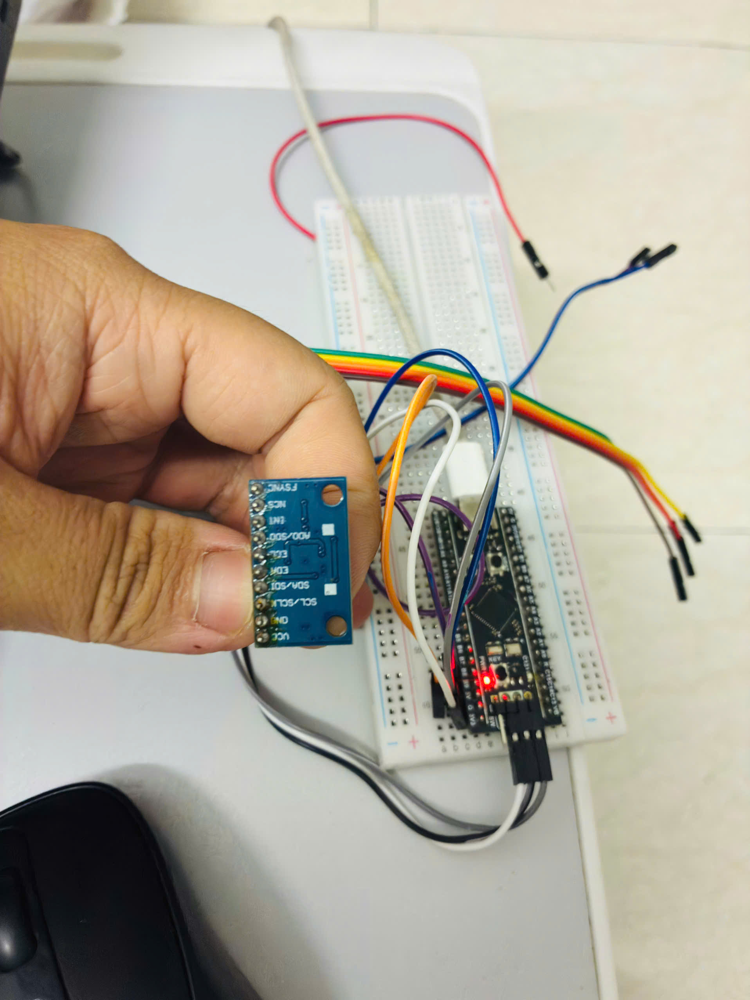

*Ảnh phần cứng thực tế (không dùng phần mềm) - Phần cứng thực tế.*

[Ảnh gốc](docs/evidence/00_hardware_original.jpg)

## 13. Hướng dẫn bằng ảnh theo thứ tự

Mỗi ảnh được crop trực tiếp từ bản gốc, loại bỏ vùng giao diện thừa và giữ bằng chứng kỹ thuật. Caption ghi phần mềm chính. Nhấn ảnh gốc để đọc nguyên bản. Ảnh cấu hình và debug được sắp theo mục đích hướng dẫn, không phải thứ tự thời gian chụp.

### 01. Nhận diện MPU6500

Watch: WHO_AM_I = 0x70 và I2C HAL_OK. Đây là bước thử nhận diện ban đầu.

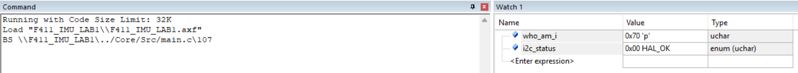

*Keil µVision - 01. Nhận diện MPU6500.*

[Ảnh gốc 124400](docs/evidence/14_whoami_original.png)

### 02. Clock 84 MHz và USB 48 MHz

HSE 25 MHz; PLL M=25, N=336, P=4, Q=7. SYSCLK 84 MHz; USB 48 MHz.

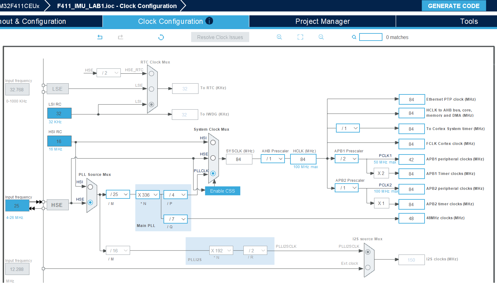

*STM32CubeMX - 02. Clock 84 MHz và USB 48 MHz.*

[Ảnh gốc 141948](docs/evidence/01_clock_original.png)

### 03. TIM2 lấy mẫu 100 Hz

PSC=8399; ARR=99; timer clock 84 MHz. 84 MHz / 8400 / 100 = 100 Hz.

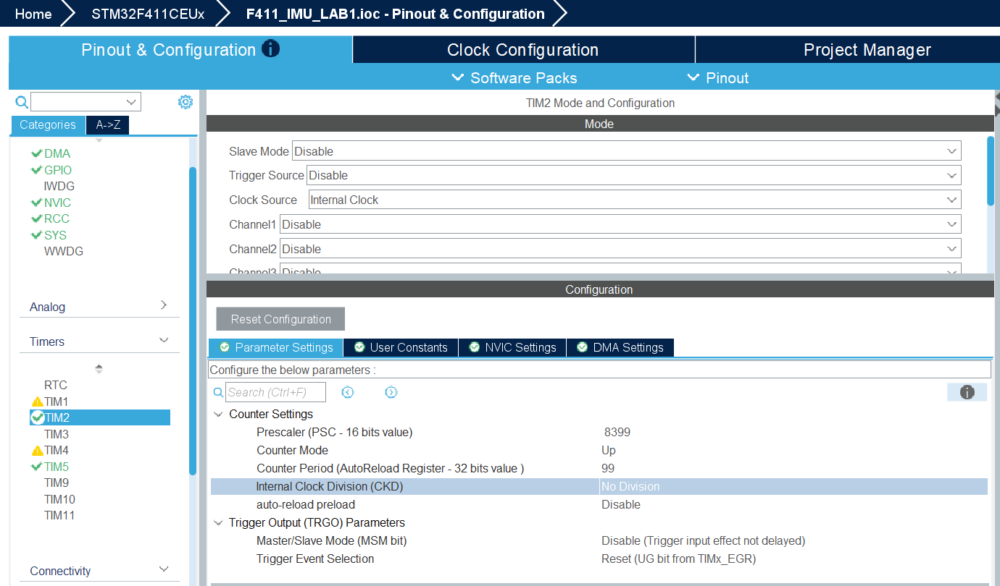

*STM32CubeMX - 03. TIM2 lấy mẫu 100 Hz.*

[Ảnh gốc 142134](docs/evidence/02_tim2_original.png)

### 04. Ngắt TIM2

Bật TIM2 global interrupt. Ảnh này chỉ minh họa bật ngắt; thông số timer cuối nằm ở ảnh trước.

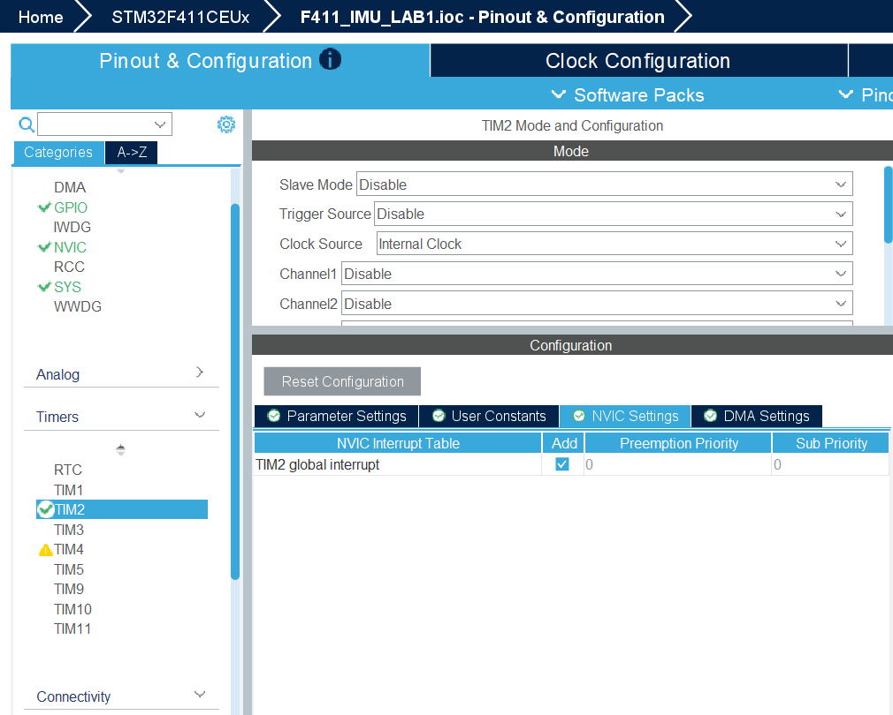

*STM32CubeMX - 04. Ngắt TIM2.*

[Ảnh gốc 134416](docs/evidence/12_tim2_irq_original.png)

### 05. TIM5 timestamp 1 us

PSC=83; Period=4294967295 (0xFFFFFFFF). Timer clock 84 MHz cho 1 tick = 1 us.

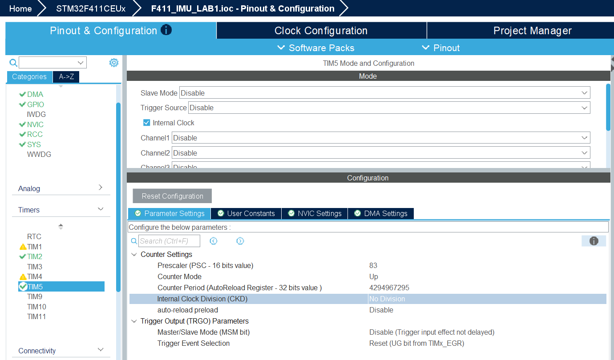

*STM32CubeMX - 05. TIM5 timestamp 1 us.*

[Ảnh gốc 142218](docs/evidence/03_tim5_original.png)

### 06. I2C1 RX DMA

DMA1 Stream0; Peripheral To Memory; High; Normal; Memory Increment; dữ liệu Byte. Channel 1 đối chiếu source MSP.

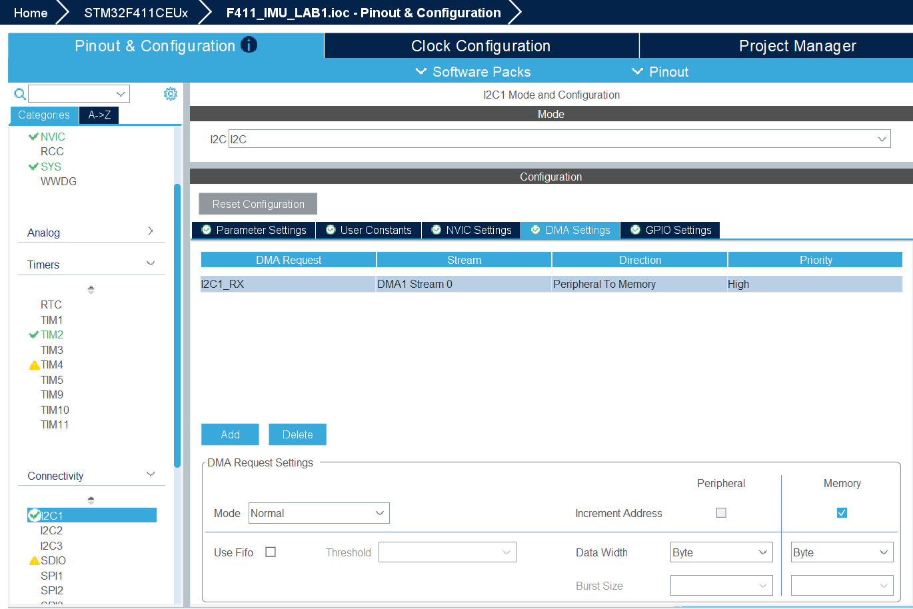

*STM32CubeMX - 06. I2C1 RX DMA.*

[Ảnh gốc 134754](docs/evidence/04_dma_original.png)

### 07. NVIC cho I2C và DMA

DMA1 Stream0 global interrupt, I2C1 event và I2C1 error đều được bật.

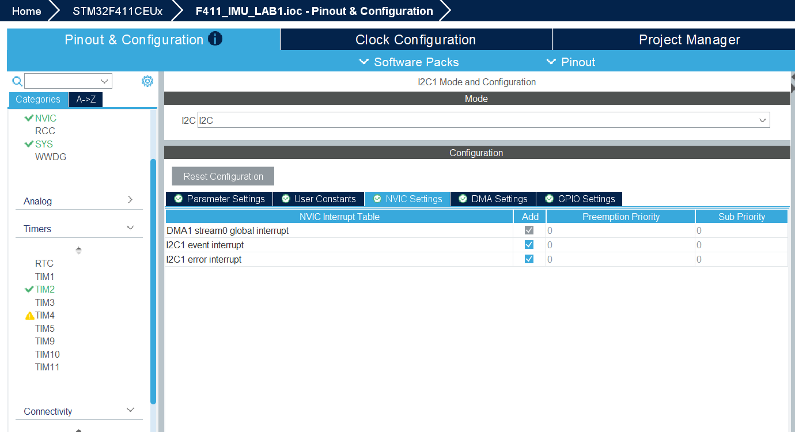

*STM32CubeMX - 07. NVIC cho I2C và DMA.*

[Ảnh gốc 134746](docs/evidence/05_nvic_original.png)

### 08. USB OTG FS Device Only

USB_OTG_FS: Device_Only; Device Full Speed 12 MBit/s. Đây là tốc độ bus USB, không phải tần số lấy mẫu.

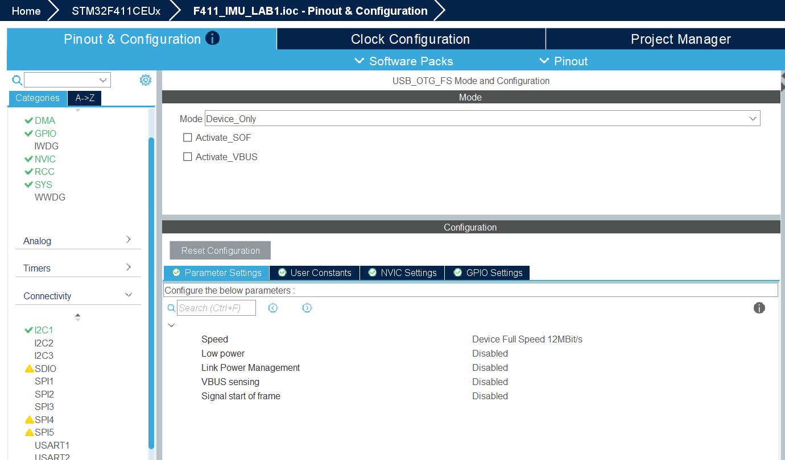

*STM32CubeMX - 08. USB OTG FS Device Only.*

[Ảnh gốc 142247](docs/evidence/13_usb_mode_original.png)

### 09. USB_DEVICE CDC

Class For FS IP: Communication Device Class (Virtual Port Com). Tạo cổng COM ảo qua USB.

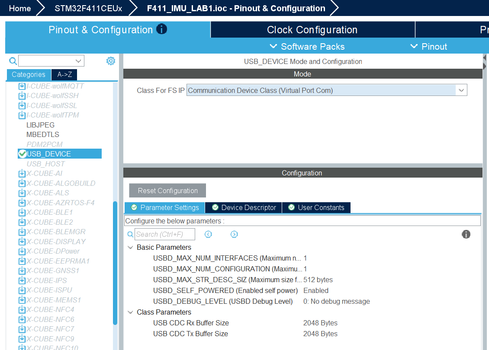

*STM32CubeMX - 09. USB_DEVICE CDC.*

[Ảnh gốc 142830](docs/evidence/06_cdc_original.png)

### 10. Keil build và Flash Verify OK

Build: 0 Error(s), 0 Warning(s). Programming Done và Verify OK. Kết quả từ ảnh gốc, không chạy lại.

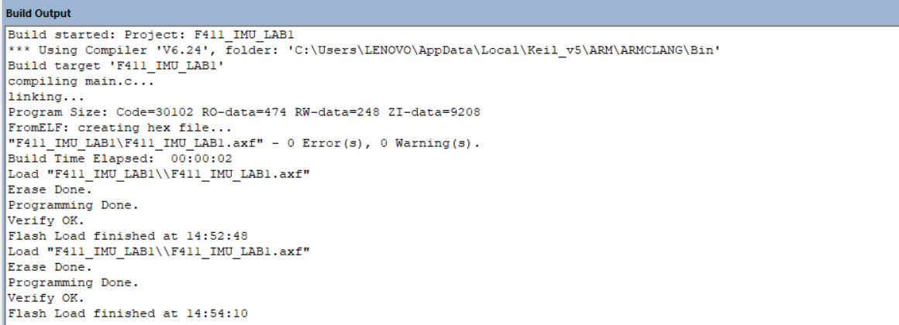

*Keil µVision - 10. Keil build và Flash Verify OK.*

[Ảnh gốc 145426](docs/evidence/07_build_flash_original.png)

### 11. Windows nhận COM5

Device Manager hiển thị USB Serial Device (COM5). COM3 trong cùng danh sách là thiết bị khác.


*Windows Device Manager - 11. Windows nhận COM5.*

[Ảnh gốc 173501](docs/evidence/08_com5_original.png)

### 12. Benchmark Python 10 s

1000 frames; 0 CRC; 0 lost; 99.96 Hz. File [imu_20261101_145817.csv](docs/evidence/benchmark/imu_20261101_145817.csv) có 1000 dòng theo kiểm tra CSV.

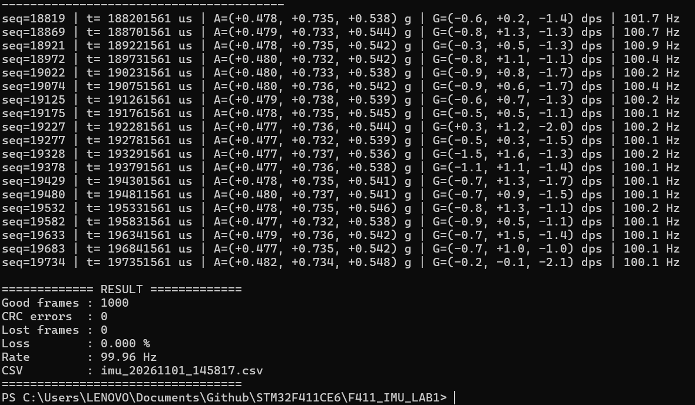

*Windows PowerShell / Python - 12. Benchmark Python 10 s.*

[Ảnh gốc 145837](docs/evidence/09_benchmark_original.png)

### 13. Thu dataset theo class và session

Phần trên: idle 01 đã đạt 6001 frames, 99.99 Hz. Phần dưới: bắt đầu idle 02 trong 60 s; không gán kết quả idle 01 cho idle 02.

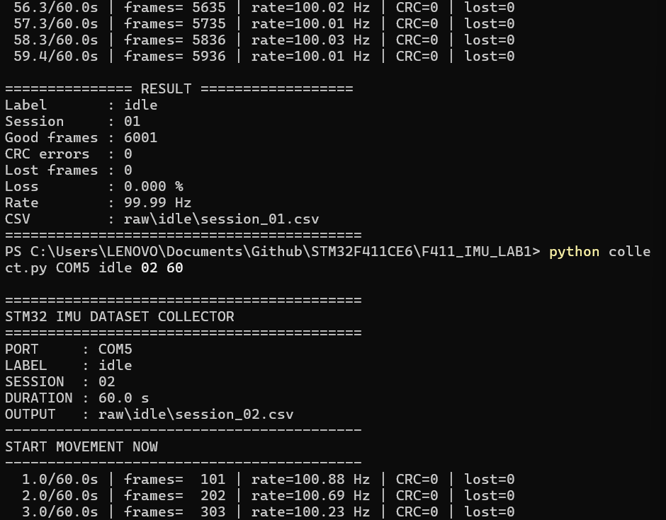

*Windows PowerShell / Python - 13. Thu dataset theo class và session.*

[Ảnh gốc 174639](docs/evidence/10_collector_original.png)

### 14. Hoàn tất 15 CSV

updown 03: 6001 frames; 0 CRC; 0 lost; 99.99 Hz. Lệnh đếm ra 15; danh sách updown có session_01/02/03. Audit xác nhận 5 class x 3 session.

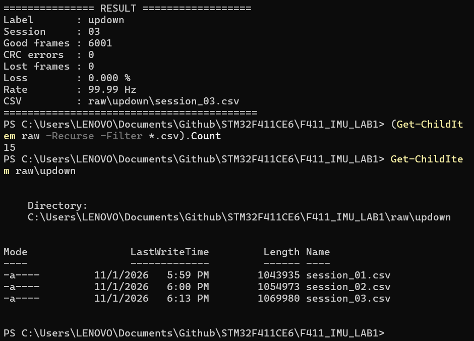

*Windows PowerShell / Python - 14. Hoàn tất 15 CSV.*

[Ảnh gốc 181343](docs/evidence/11_dataset_complete_original.png)
